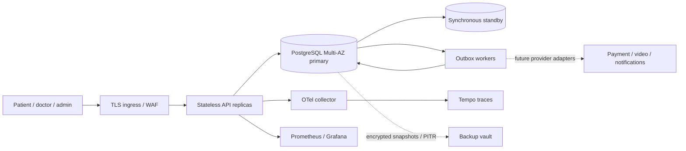
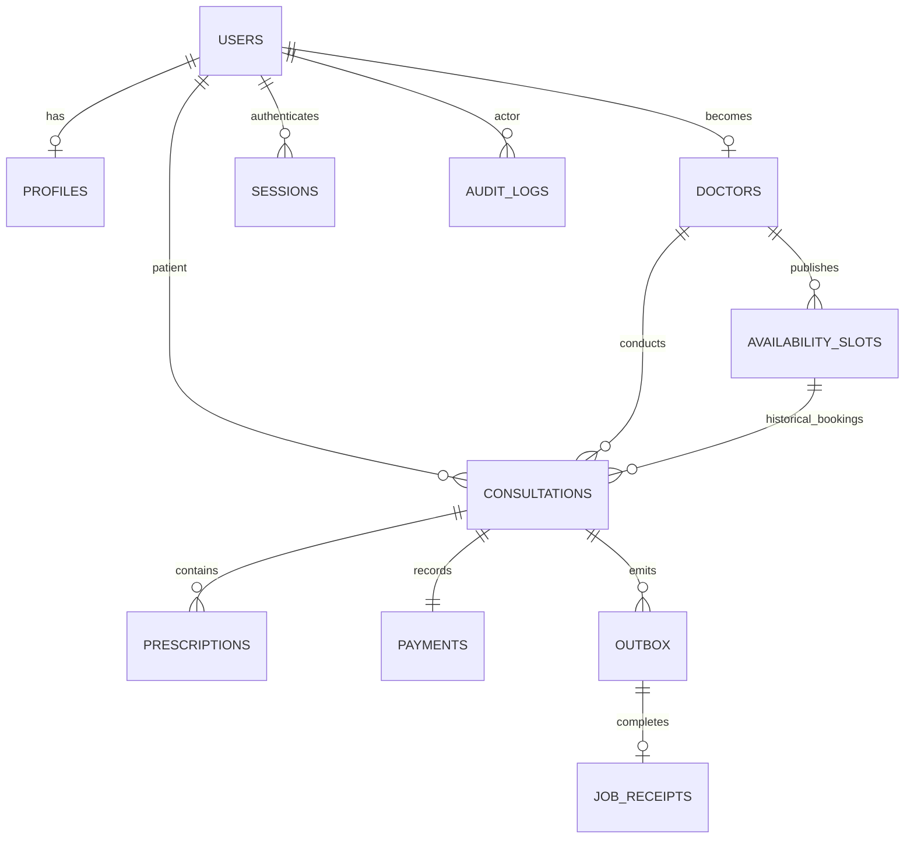

# Architecture — Amrutam

## Page 1 of 4 — system and data flow

**Decision:** a stateless modular monolith plus independently scalable workers. At 100,000 consultations/day the mean booking rate is 1.16/s. Assuming 30 API requests per consultation gives ~35 requests/s average; a 20× peak gives ~700 requests/s. This is a capacity hypothesis to validate, not a benchmark. Three API replicas across availability zones start the deployment; HPA grows to twelve. Each has a 20-connection pool; reserve database headroom for workers, migrations and operations. Add PgBouncer before raising replica limits beyond the database connection budget.



The API owns identity, directory, scheduling and clinical modules. Dependencies are passed into the app and transaction boundary; modules receive a typed route context. PostgreSQL is the source of truth. Writes validate inputs, authenticate the live session, enforce role and record ownership, execute a single transaction, and emit an outbox record. Workers never run a remote request inside a clinical database transaction.

Clinical records use AES-256-GCM envelope fields with record-specific associated data and a versioned key identifier. Storage encryption covers the whole database and backups. Session credentials are random opaque values, stored as keyed hashes. Profiles, TOTP secrets, prescription content and idempotency responses are application-encrypted. Email and relationship metadata remain searchable plaintext inside the encrypted database and are classified as sensitive.

Availability target: 99.95% monthly, approximately 21.6 minutes unavailability per 30 days. Health checks, rolling deployments with zero unavailable API replicas, disruption budgets and Multi-AZ database failover support the target. They do not establish an SLA. Measure from an external synthetic probe as well as API success metrics.

<div style="page-break-after: always;"></div>

## Page 2 of 4 — booking and consistency

```mermaid
sequenceDiagram
  participant P as Patient
  participant A as API
  participant D as PostgreSQL
  participant W as Worker
  P->>A: POST consultation + access token + idempotency key
  A->>D: Authenticate, rate limit
  A->>D: BEGIN; advisory lock on actor + key
  A->>D: Read stored request hash / response
  alt exact committed replay
    D-->>A: Encrypted original result
  else new write
    A->>D: Lock future slot FOR UPDATE
    A->>D: Check doctor and existing booking
    A->>D: Insert consultation + uncollected payment
    A->>D: Insert audit + outbox + encrypted response
  end
  A->>D: COMMIT
  A-->>P: 201, stable consultation ID
  W->>D: Claim outbox FOR UPDATE SKIP LOCKED
  W->>D: Refresh daily aggregate + receipt; COMMIT
```

The partial unique index on `consultations(slot_id)` where status is not cancelled is the final defense against double booking. A slot row lock makes the loser receive a predictable 409. Slot creation locks the doctor row before checking time-range overlap; all availability writes must use this API. Patient ownership and assigned-doctor checks prevent insecure direct object references. Admin authority does not grant clinical access.

Idempotency is scoped to actor + key; the hash covers normalized JSON, method and path. The lock, domain mutation, audit, outbox and stored response commit together. A crash before commit leaves no partial write; a crash after commit returns the original response on retry. Different request content with the same key returns 409. The storage policy retains responses seven days; clients must never intentionally reuse keys. Authentication is still checked before replay, so revoked or expired tokens cannot retrieve results.

Consultations transition `booked → in_progress → completed`, or `booked → cancelled`. Prescription issuance locks the consultation and requires the assigned doctor while in progress. Cancellation voids an **uncollected** payment and releases the unique booking claim. Real payment capture is explicitly outside the implemented path. A future capture saga needs provider idempotency, signed webhook verification, event deduplication and compensation (refund or slot release); a database rollback cannot undo an external charge.

Retry 503/network failures with the same idempotency key, honoring `Retry-After`, exponential backoff and full jitter, capped at three attempts in the client. Do not retry validation, authorization or booking conflicts. Worker retry delay is exponential with jitter, capped at five minutes; eight failed attempts dead-letter the job. Job effects and completion are transactional. Future external side effects require provider-level idempotency because delivery will be at least once.

<div style="page-break-after: always;"></div>

## Page 3 of 4 — data and scaling



Primary IDs are UUIDs; time is stored as `timestamptz` and analytics use UTC days. Search has bounded parameters and page size ≤100. Directory and consultation listing use UUID keyset cursors, not expensive offsets. Slots use a start-time cursor, unique per doctor. Audit export currently uses a bounded timestamp window; use a timestamp/UUID composite cursor before building a complete bulk-export product, because a timestamp-only page can omit rows tied at the boundary.

At sustained 100k consultations/day, annual volume is ~36.5 million consultations plus audit, event and prescription rows. The initial schema is intentionally unpartitioned so global slot uniqueness and foreign keys remain simple. At measured index/maintenance pressure, partition append-only audit/outbox history monthly by creation time; add a composite `(created_at,id)` key and update foreign keys such as job receipts. Partition consultations only after designing a separate global active-slot-claims table, since a partition-local unique index would not protect booking uniqueness across months. Archive cold encrypted clinical records according to approved retention policy. Migration and performance testing are prerequisites; partitioning is a documented evolution, not enabled in this schema.

No distributed cache is needed for correctness. All protected responses are `Cache-Control: no-store`. A future 30–60 second Redis cache may serve verified public doctor attributes, keyed by filters/version and invalidated via the outbox. Never treat cached slot availability as a booking guarantee. Clinical records and bearer tokens are not cached in a shared CDN. Read replicas may serve directory and administrative reports where staleness is acceptable; booking and read-after-write clinical access stay on the primary.

Analytics refresh asynchronously and return `refreshed_at`. The worker serializes updates per UTC day, recomputes exact counts and commits a receipt. This simple aggregation scans one day's indexed data per event; at high volume replace it with batched refresh jobs or delta projections with event deduplication. The outbox age alert detects lag while this scaling threshold is measured.

<div style="page-break-after: always;"></div>

## Page 4 of 4 — reliability and operational boundaries

RDS uses Multi-AZ, storage encryption, deletion protection, automatic minor upgrades and 35-day PITR retention. Target **regional RPO ≤5 minutes / RTO ≤60 minutes** requires asynchronous encrypted cross-region backup replication, matching keys and a tested warm network/cluster. Terraform currently provisions same-region backups; cross-region copies and restore drills are a release gate, not an implemented guarantee. Conduct monthly isolated point-in-time restores and quarterly regional exercises. Verify schema, record counts, sampled authenticated decryptions, audit continuity and a synthetic booking before switching traffic. Keep old encryption keys for every retained backup.

Migration scripts acquire a global advisory lock and apply versioned SQL atomically. Use expand/contract changes: add compatible structures, deploy dual-compatible code, backfill in bounded batches, then remove old fields in a later release. Do not roll back clinical data as part of an application rollback. Deployment uses immutable images and waits for API readiness before updating workers.

Prometheus measures requests, status and latency by route template; no user IDs enter metric labels. JSON logs include generated request ID and trace ID, never request bodies or auth tokens. OTel exports traces through a collector that removes SQL text and URL/query attributes. `/metrics` requires a separate secret and is excluded from public ingress. Worker pending count, oldest age and dead letters are measured through the API scrape. A production logging backend, alert receiver, external probe and managed telemetry storage must be connected by the operator.

Per-IP and per-account rate limits use atomic shared database counters, preserving behavior across replicas. The edge must also enforce volumetric limits. The app ignores forwarded client IPs by default; behind ingress its IP bucket is shared by the proxy. Configure an explicit trusted-proxy allowlist before adopting forwarded addresses; never trust arbitrary client headers. Password work is limited to two concurrent scrypt operations per process to bound memory, with 503 on overload. Authentication latency is reported separately from domain writes; the target must be validated and negotiated for expensive password operations.

References: PostgreSQL [row locking](https://www.postgresql.org/docs/17/explicit-locking.html), [partitioning limitations](https://www.postgresql.org/docs/17/ddl-partitioning.html), OWASP [password storage](https://cheatsheetseries.owasp.org/cheatsheets/Password_Storage_Cheat_Sheet.html) and [MFA](https://cheatsheetseries.owasp.org/cheatsheets/Multifactor_Authentication_Cheat_Sheet.html). These inform the design; they do not certify regulatory compliance.
